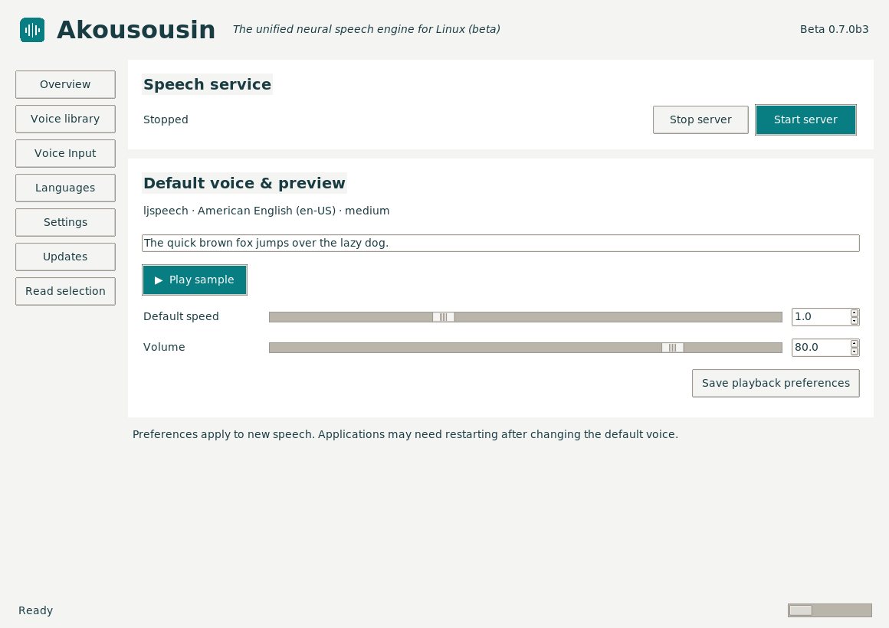

<!--
SPDX-License-Identifier: GPL-3.0-or-later
SPDX-FileCopyrightText: 2026 John Goodman
-->

# Akousousin — Neural Voice Engine

**akousousin:** *The unified neural speech engine for Linux, implementing Microsoft SAPI and Speech Dispatcher, based on Piper and Whisper.*

**Main version: 0.7.0b3 beta.** [Downloads and release notes](https://github.com/jg00dman/akousousin/releases).

<!-- akousousin-screenshot:start -->

<!-- akousousin-screenshot:end -->

[More screenshots: Voice Input, recording controls and Read selection](docs/SCREENSHOTS.md).

Core speech output works through 64-bit SAPI (Wine and native Windows) and the
native Linux Speech Dispatcher output module. On-demand startup, idle model
unloading and control-panel update checks are included. Neither output interface
has full API coverage.

This beta adds **experimental local Whisper voice input on Linux**, a Voice Input
panel and KDE Wayland shortcut dictation. Microphone discovery, recording and
insertion into Kate and a chat text field were desktop-tested on Kubuntu 26.04
Wayland. SAPI recognition and native Windows microphone capture are not implemented.
See the [Voice Input guide](recognition/PANEL-TESTING.md) and
[dictation implementation and acceptance checks](recognition/DICTATION.md).

The name comes from Greek **ἀκούσουσιν**, “they will hear” (John 5:25).

| API area | Implemented | Partial / remaining |
| --- | --- | --- |
| SAPI engine integration | COM activation, voice tokens/enumeration, `ISpTTSEngine` and `ISpObjectWithToken` | Application-facing SAPI is supplied by Windows/Wine; not a complete SAPI implementation |
| SAPI speech output | Text/Unicode, voices, rate, volume, silence, async host use, cancellation and cold startup | Language hints and limited XML effects; full pause/resume, skip, word events, pitch, phonemes/visemes and general SSML incomplete or unsupported |
| Speech Dispatcher output | Server audio, voice/language selection, rate/volume, text, characters/keys, cancellation and lifecycle events | Daemon owns queues/priorities; no separate speechd server |
| Orca and reading feedback | SSML text/entities, coarse index marks, punctuation and spelling fallback | Exact word highlighting, full resume-position validation, localized symbols and sound icons remain |
| Shared runtime and updates | Piper, voice library/preferences, on-demand loading, idle unloading, optional registration, update checks and Linux AppImage updates | AppImage-only weekly checks and stable/beta selection; other packages use their installation source; speechd pitch and functional debug/log-level controls are absent |
| Speech input | Experimental multilingual Whisper recognition, microphone/language selectors and KDE Wayland dictation | Linux capture only; SAPI recognition, spoken punctuation commands and document proofing-language tagging are not implemented |

See **[API coverage and implementation status](COMPATIBILITY.md)** for the
command/interface matrix, unsupported operations and validation evidence.
We report feature coverage rather than an invented percentage of the full APIs.

Global selected-text reading is available on KDE Wayland through the Read selection
page. It needs Speech Dispatcher and wl-clipboard; Wine applications may require
the explicit copied-text fallback. Suggested global shortcuts are **Ctrl+Alt+R**
(selected text / stop) and **Ctrl+Alt+Shift+R** (copied text / stop), subject to KDE
approval. See the [setup guide](standalone/README.md#global-read-selected-text--stop)
and [beta test checklist](standalone/BETA-TESTING.md).

## Try the beta

Download the [Linux AppImage or Windows ZIP](https://github.com/jg00dman/akousousin/releases).
[Installation and configuration instructions](standalone/README.md) cover paths,
voices, Wine-prefix registration, launcher commands and rollback.

The Linux package contains the voice engine, control panel, tray and Piper backend,
with voice models downloaded on demand. On first use, choose the reviewed
`en_US-ljspeech-medium` starter voice (about 64 MB), another catalogue voice, or
import a local model. Offline builds can include the starter voice. It does not contain Wine.
Existing voice choices are preserved. Other models retain their own licence terms.
The build target remains x86-64 Linux with glibc 2.35+ (Ubuntu 22.04), and existing
working 64-bit Wine prefixes. Wine compatibility DLLs stay in the AKS directory;
SAPI COM registrations select them without changing Wine system DLLs or PATH.
Native Windows system SAPI is not replaced.

Akousousin uses one configuration per user. On Linux, config is under
`~/.config/Akousousin`, downloaded voices under `~/.local/share/Akousousin`,
and logs under `~/.local/state/Akousousin`. The AppImage runs wherever you place
it; `~/.local/share/Akousousin/Akousousin-x86_64.AppImage` is the recommended path.
XDG overrides are respected. Closing the panel leaves speech available; Quit stops
Piper and exits the resident application. SAPI can start speech on demand without
launcher lifecycle hooks. An optional session interface remains available to clients.

## Implementation and validation

The standalone [engine](engine/) implements public Windows COM/SAPI interfaces.
Those standard API names and contracts are unchanged by the project rebrand.
The [control panel and controller](standalone/) manage voices and backend sessions.
The panel uses Tkinter; the tray/controller uses PySide6 (Qt 6). Speech Dispatcher
output for Orca does not establish control-panel accessibility; comprehensive
Orca/AT-SPI support remains future work.
[CI](.github/workflows/standalone.yml) cross-compiles the engine and tests packages
on Wine and Windows without compiling Wine. The CI suite checks controller and recognition lifecycle, cancellation, actual GUI
scrolling and recording actions, portal protocol behavior, packaged panel shutdown,
Wine/Windows integration and failures, real Piper output, registration refresh and rollback.
Linux checks also exercise a real speechd daemon, packaged Whisper inference and verified AppImage updating.

The [Wine patches](patches/) and [Wine build workflow](.github/workflows/appimage.yml)
remain available for custom Wine builds. Wine compilation belongs in GitHub Actions,
not the cloud development environment. Matching sources and licence notices
accompany downloadable packages. Engine code is LGPL-2.1-or-later; panel/service
and Piper are GPL-3.0-or-later; dependency and voice notices are included.

The next output milestones are exact alignment-backed word events, more complete
pause/resume behaviour and broader speech markup/accessibility support.
SAPI recognition and a future native input framework remain separately scoped. See the
[Speech Dispatcher desktop checklist](standalone/SPEECH-DISPATCHER.md#desktop-acceptance-checklist)
for ongoing Orca and application testing.

## Licensing

Original Akousousin project source is **GPL-3.0-or-later**, copyright 2026 John
Goodman. The SAPI engine C implementation and API headers are **LGPL-2.1-or-later**;
Wine copyright notices are retained. Dependencies, imported code, models and Wine
patches retain their own licences. See [LICENSE](LICENSE), the
[LGPL text](LICENSES/LGPL-2.1-or-later.txt), and [component licensing](LICENSING.md).
Both application packages include the GPL/LGPL texts and upstream notices.
