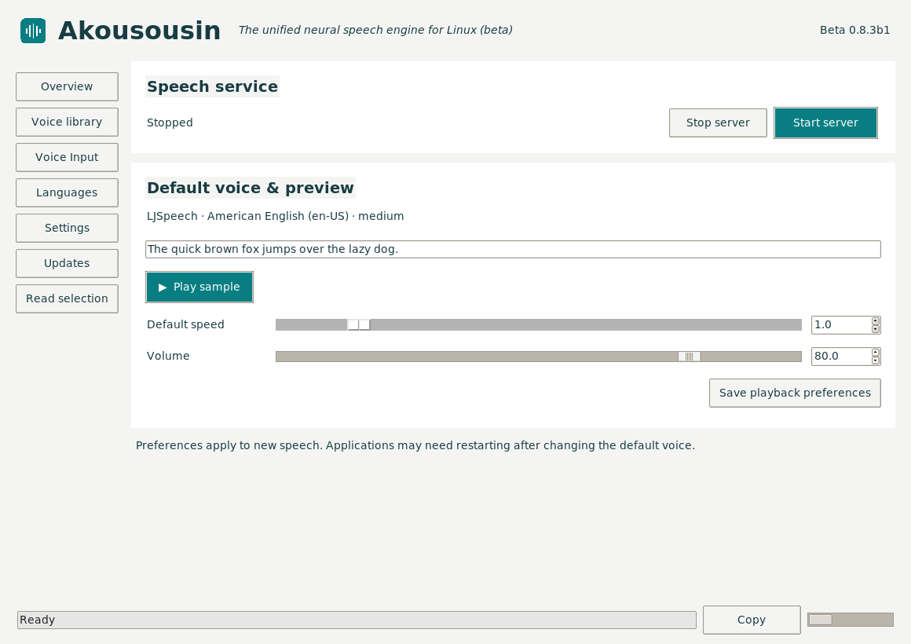

<!--
SPDX-License-Identifier: GPL-3.0-or-later
SPDX-FileCopyrightText: 2026 John Goodman
-->

# Akousousin

**Natural-sounding speech and dictation for the Linux desktop.** Hear any text
read aloud, dictate into any app, and give Windows apps running in Wine a
voice. Everything runs on your computer.

**[Download Akousousin 0.9](https://github.com/jg00dman/akousousin/releases/latest)** ·
[User guide](standalone/README.md) · [Screenshots](docs/SCREENSHOTS.md) ·
[What's new](standalone/RELEASE-NOTES.md)

<!-- akousousin-screenshot:start -->

<!-- akousousin-screenshot:end -->

## The name

**ἀκούσουσιν** (*akousousin*) is Greek for “they will hear”, from John 5:25:
*“the dead will hear the voice of the Son of God, and those who hear will live.”*

Akousousin began as part of the effort to run Logos Bible Software on Linux
through Wine. That work exposed a wider gap: Linux desktops had no good
built-in way to hear text read aloud naturally or to dictate. Akousousin grew to
fill it, for any app. Support for the biblical languages, Greek and Hebrew, is
the goal for version 1.0.

## What it does

- **Read aloud, anywhere.** Select text in any app and press a shortcut to hear
  it. Press again to stop.
- **Dictate into any app.** Press a shortcut and speak; your words are typed
  where you are working.
- **Voices for Windows apps in Wine.** Apps such as Logos use Akousousin through
  SAPI, the Windows speech system, with no changes to Wine itself.
- **Voices for Linux apps and screen readers.** Orca, Firefox and other apps
  that use Speech Dispatcher can speak with Akousousin voices.
- **Private by design.** Text and recordings never leave your computer. There
  are no accounts and no tracking.

## Why not just Piper and Whisper?

[Piper](https://github.com/OHF-Voice/piper1-gpl) makes speech and
[Whisper](https://github.com/openai/whisper) recognises it. Both are excellent
engines, but on their own they are command-line tools. Akousousin builds them
into the desktop:

| You get | What Akousousin adds |
| --- | --- |
| One voice everywhere | A single voice library and settings shared by Wine apps, Linux apps, Orca and your own shortcuts |
| Windows apps that speak | A SAPI speech engine registered in your Wine prefix, with rollback |
| Linux apps that speak | A Speech Dispatcher module, set up for you and easy to remove |
| Shortcuts that work in every app | Global shortcuts through your desktop's own approval (Plasma and GNOME on Wayland) |
| Dictation that types for you | Microphone handling, speech detection and typing into the focused app |
| 178 voices in 53 languages | Browse, preview and download voices, each with its licence |
| Something you can just use | A control panel, a tray icon, start at login, and models kept ready |

## Install

Download from the [latest release](https://github.com/jg00dman/akousousin/releases/latest):

- **AppImage** (recommended): make it executable and open it. Akousousin
  offers to install itself and add a menu entry.
- **Linux tar.gz**, for systems without AppImage support: extract it and run
  `./install.sh`.
- **Windows ZIP**: experimental. Full Windows support is still to come.

Needs 64-bit Linux with glibc 2.35 or newer (Ubuntu 22.04, SteamOS 3 and most
current distributions), and PipeWire or PulseAudio. An English voice is included;
others download when you choose them. See the [user guide](standalone/README.md)
for details.

## Status

Version 0.9 is a stable release. Not yet done:

- Greek and Hebrew voices and dictation, planned for 1.0.
- Dictation into other apps on X11. Reading shortcuts work there through a
  desktop action you bind to keys yourself.
- Speech recognition for Windows apps, and native Windows dictation.

Detailed API coverage is in [COMPATIBILITY.md](COMPATIBILITY.md).

## Credits and licence

Speech synthesis by [Piper](https://github.com/OHF-Voice/piper1-gpl) (Open
Home Foundation). Speech recognition models by OpenAI's Whisper, run with
[faster-whisper](https://github.com/SYSTRAN/faster-whisper) and CTranslate2.
Speech detection by [Silero VAD](https://github.com/snakers4/silero-vad).

Akousousin is © 2026 John Goodman, licensed under the GPL-3.0-or-later. The SAPI
engine's C code is LGPL-2.1-or-later and keeps Wine's copyright notices. Each
voice has its own licence. See [LICENSING.md](LICENSING.md).

[For developers and translators](docs/DEVELOPMENT.md)
