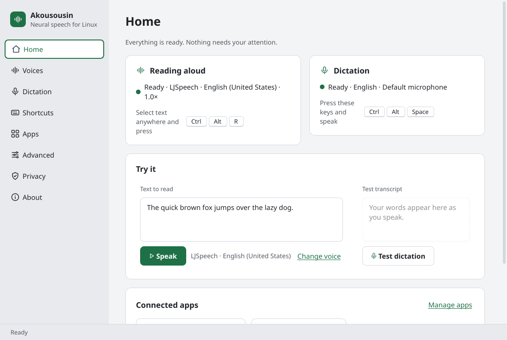
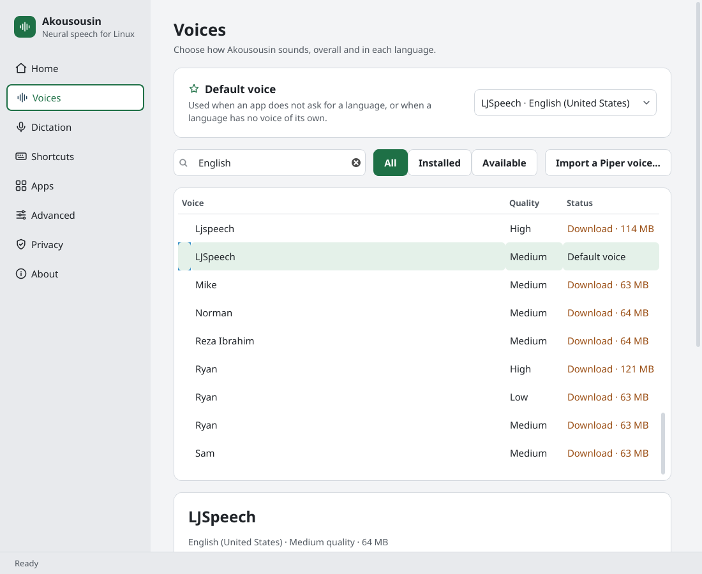
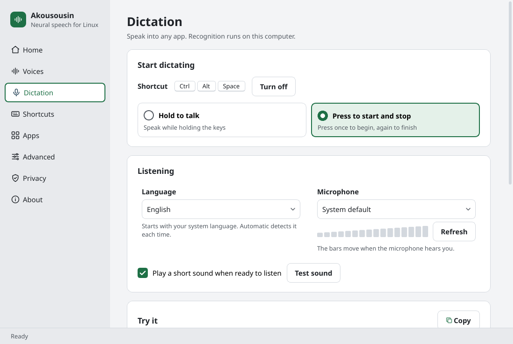
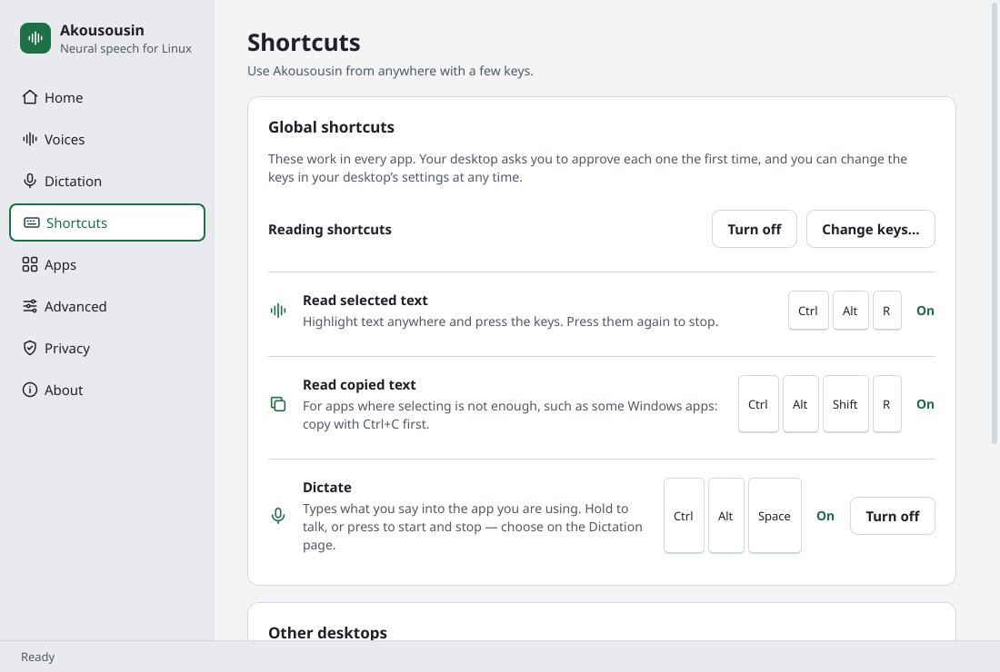
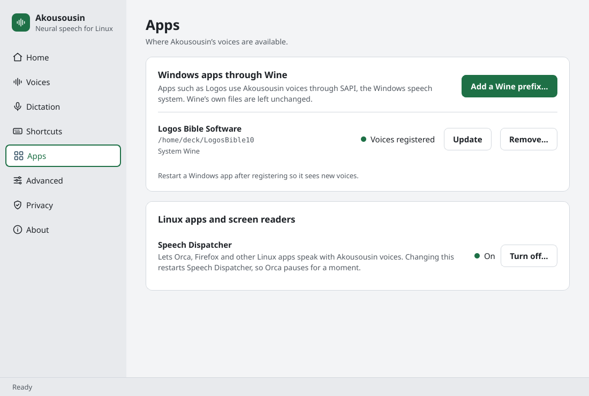
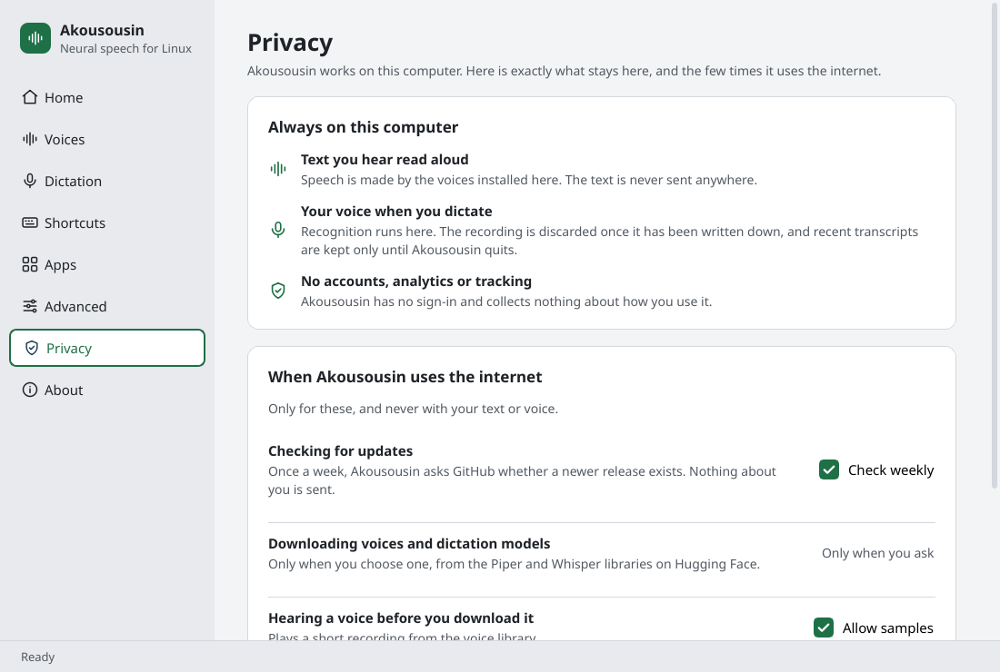
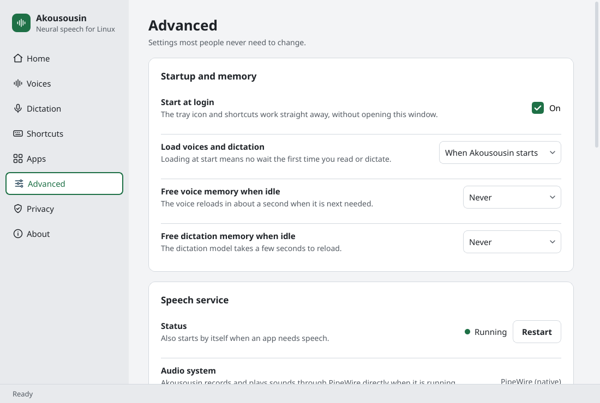
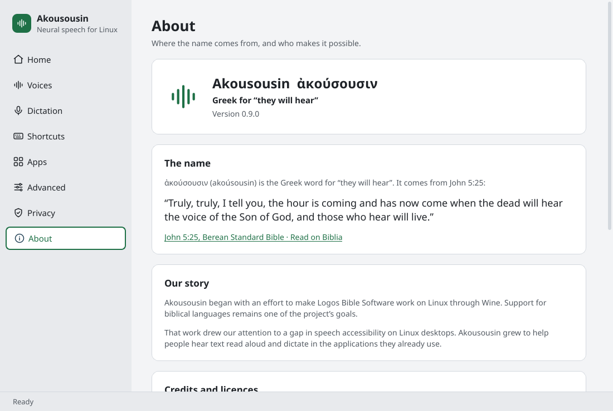
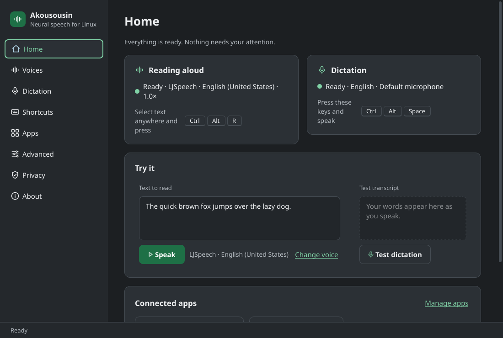
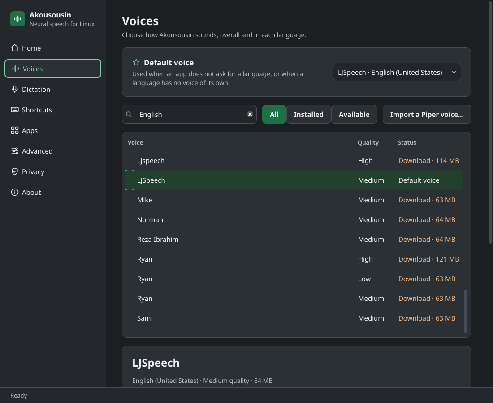

<!--
SPDX-License-Identifier: GPL-3.0-or-later
SPDX-FileCopyrightText: 2026 John Goodman
-->

# Screenshots

Akousousin 0.9 on a Plasma desktop. It follows your desktop's light or dark
colours.

**Home:** whether reading aloud and dictation are ready, your shortcuts, and a
place to try both.

**Voices:** the default voice, then every voice by language. Select one to hear
it, use it, download it or remove it.

**Dictation:** shortcut, hold-to-talk or press-to-start, language and
microphone, with a live level meter.

**Shortcuts:** reading and dictation keys that work in every app.

**Apps:** Windows apps in Wine, such as Logos, and Linux apps through Speech
Dispatcher.

**Privacy:** what stays on your computer, and the few times Akousousin uses the
internet.

**Advanced:** start at login, memory, the speech service, updates and
troubleshooting.

**About:** the name, the story and the credits.

**Dark:**

