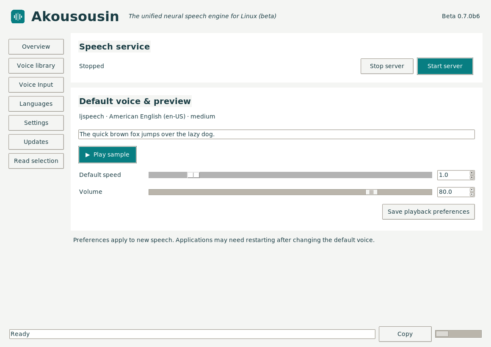
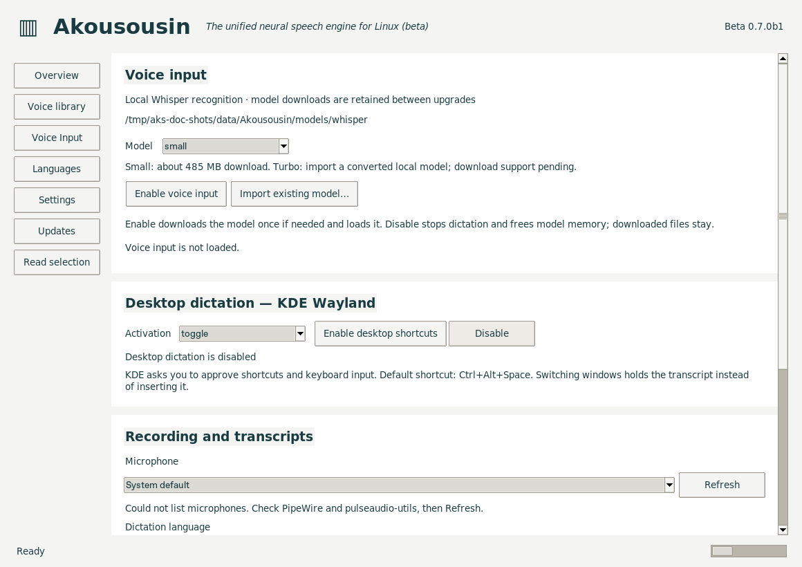
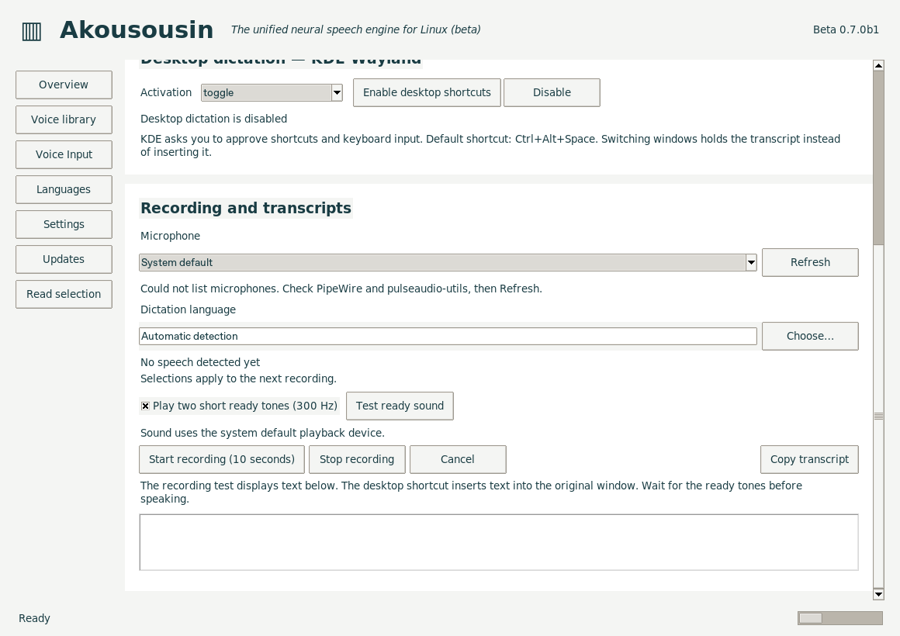
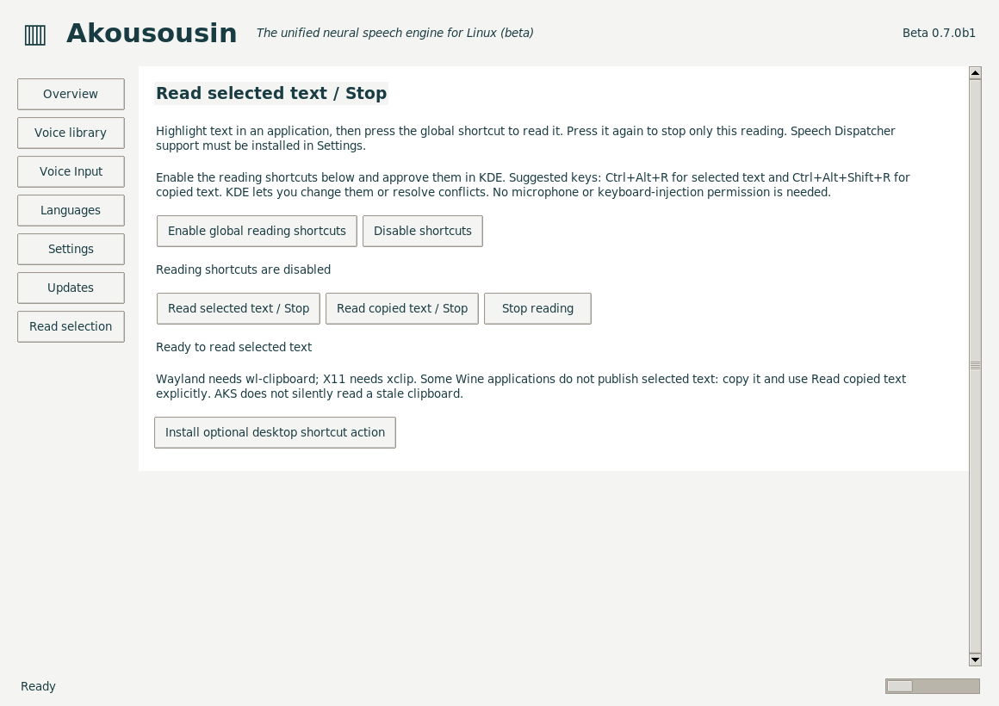

<!--
SPDX-License-Identifier: GPL-3.0-or-later
SPDX-FileCopyrightText: 2026 John Goodman
-->

# Akousousin screenshots

These images show the actual Linux control panel. The overview was captured
during the latest release checks; the input and reading pages show 0.7.0b1
(their controls are unchanged in 0.7.0b2), captured from source in an isolated profile on a virtual X display. They show
setup states, not completed desktop permission or microphone tests. The temporary
model path in the input screenshots belongs to that isolated profile; the normal
cache is `~/.local/share/Akousousin/models/whisper/`, respecting `XDG_DATA_HOME`.

## Overview

Speech service controls, the selected voice, preview and playback preferences.

## Voice Input

Persistent model management, toggle/push-to-talk and KDE shortcut setup. The
model is unloaded and shortcuts are disabled. This capture environment has no
host microphone utilities; a desktop with `pulseaudio-utils` lists its inputs.

Scroll down for microphone and language selection, the ready-sound test, recording
controls and transcripts.

## Read selection

Global reading shortcut setup, selected/copied text actions and stopping the
reader. Enable the shortcuts and approve them in KDE before using them globally.

See the [installation guide](../standalone/README.md),
[Voice Input guide](../recognition/PANEL-TESTING.md) and
[beta testing checklist](../standalone/BETA-TESTING.md).
