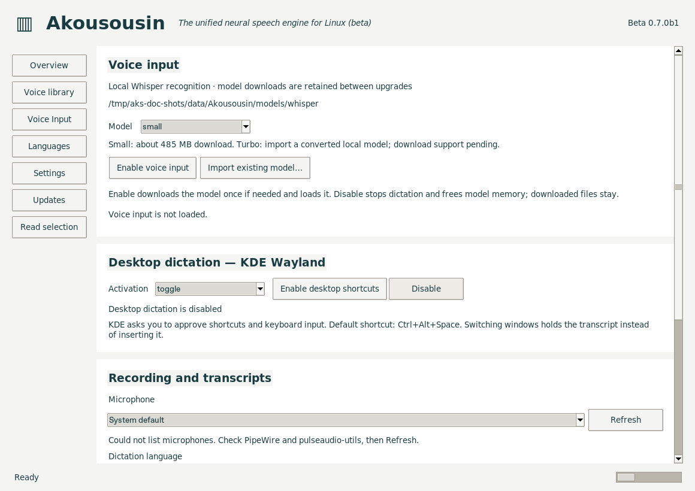
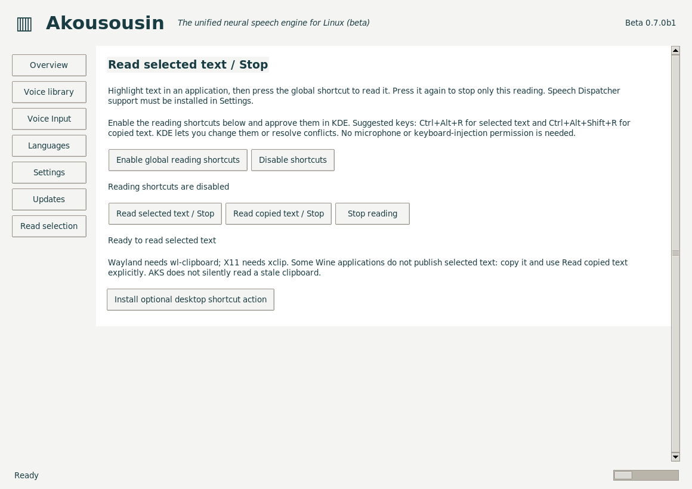

<!--
SPDX-License-Identifier: GPL-3.0-or-later
SPDX-FileCopyrightText: 2026 John Goodman
-->

# Akousousin — Neural Voice Engine

**akousousin:** *The unified neural speech engine for Linux, implementing Microsoft SAPI and Speech Dispatcher, based on Piper and Whisper.*

The 0.7.0b3 beta implements SAPI text-to-speech using Piper, native Linux Speech
Dispatcher output and experimental local Whisper voice input on Linux. SAPI
recognition and native Windows microphone capture are not implemented. See the
[compatibility table](../COMPATIBILITY.md) for the implemented capabilities.


[Beta downloads](https://github.com/jg00dman/akousousin/releases) · [Builds and validation](https://github.com/jg00dman/akousousin/actions).

One speech service and configuration per operating-system user. This beta contains
the standalone 64-bit SAPI engine, control panel, tray and Piper/Waitress backend.
The default package contains no Piper voice or Whisper model weights and no Wine
runtime. On first use, Overview offers the reviewed en_US-ljspeech-medium voice
(about 64 MB), or a choice from Voice library. Downloads retain upstream model
cards, checksum provenance and licence declarations. Voices stay installed in the
user data folder across upgrades. Existing selected voices are preserved. An
optional build includes LJSpeech for offline first use.

## Linux installation and storage

OuDedetai installs the AppImage to `~/.local/share/Akousousin/Akousousin-x86_64.AppImage`.
When launched from elsewhere, the control panel offers to move the AppImage to
that location and add an application-menu shortcut with a persistent AKS icon.
Choose No to keep running portably; Settings → AppImage installation lets you
retry later. An existing destination requires confirmation before replacement.
The copy is verified before registrations are refreshed and AKS restarts; the
unchanged original is removed only after the restart command succeeds. Existing
voices, models and preferences are kept. Launching an AppImage already at the
recommended path creates/refreshes its menu shortcut without a move prompt.
Custom desktop entries are preserved. The header displays the actual AKS icon.
The Ubuntu 22.04 / x86-64 / glibc 2.35+ build target is unchanged.

- Preferences: `~/.config/Akousousin/settings.json`.
- Downloaded voices: `~/.local/share/Akousousin/voices/`.
- Whisper models: `~/.local/share/Akousousin/models/whisper/`, retained between upgrades.
- Imported Piper models remain in the location you explicitly select. Whisper
  imports are copied into the persistent Whisper cache.
- Logs: `~/.local/state/Akousousin/akousousin.log`.
- Private session/socket/control files: `$XDG_RUNTIME_DIR/Akousousin/`, with a
  private `/tmp/akousousin-<uid>/Akousousin/` fallback when no runtime directory exists.

XDG directory overrides are respected. Piper and Python stay inside the AppImage.
Its temporary extraction remains alive while Akousousin runs; no additional runtime
copy is stored in the data directory. Existing `runtimes/` copies from older betas
are no longer used. Old OuDedetai-specific settings are not copied implicitly.

Close Logos before registering an existing initialized 64-bit Wine prefix:

```bash
export APPIMAGE_EXTRACT_AND_RUN=1
IMAGE="$HOME/.local/share/Akousousin/Akousousin-x86_64.AppImage"
chmod +x "$IMAGE"
"$IMAGE" --download-starter-voice  # one-time download; omit if a voice is already installed
"$IMAGE" --wine-prefix "$HOME/wine-bisect-prefix/data/wine64_bottle" \
  --wine "$HOME/akousousin/wine-akousousin-piper-11.21-logos-x86_64.AppImage" --install-only
"$IMAGE"
```

Startup itself never downloads weights. On a fresh installation choose Download
starter voice in Overview, import an `.onnx` file (matching `.onnx.json` alongside),
or review and download one in Voice library. The first installed voice becomes
the default; subsequent downloads preserve your selection. Optional offline
builds copy the bundled starter into the same persistent voice library. Select Make default, then Settings → Install /
apply voice registration. Overview → Start server → Play sample tests real Piper and
playback. Next test Logos Read Aloud using the same Wine package.

## Tray and lifecycle

The original Akousousin waveform artwork is shared by the AppImage, window and tray.
A tray badge reports stopped, starting, running or error. Downloads add a blue
arrow/progress ring and their byte counts/percentages to the tooltip and menu;
failed downloads briefly show a red indicator. The control panel shows a separate
progress bar for each download across all pages. Known-size transfers use actual
bytes received; connection, verification and unknown-size stages show activity
without a guessed percentage. Its menu provides
Start/Stop Speech, Start/Stop Dictation, Default Voice (grouped by readable
language names), Configure, Quit. Left-click toggles desktop dictation; right-click
opens the menu. Configure opens the control panel.
Default changes apply to subsequent speech; applications caching a SAPI voice may
need restarting. Newly downloaded voices need registration through Settings.

If Speech Dispatcher registration is saved but restarting fails, the panel offers
a selectable command with Copy command and separate technical details. Run the
command in your normal terminal without sudo. Registration/restart uses the host
system libraries rather than inheriting AppImage library overrides.

Closing the configuration panel leaves Akousousin/Piper running. Tray Quit stops
Piper, microphone capture, recognition/download workers and portal sessions, closes
control panels launched by that controller and exits Akousousin. It warns when
application speech sessions are active. An
application releasing the last session also stops Piper and exits Akousousin when
Akousousin was started automatically. An independent/manual start is left running.
On desktops without a tray, the panel and command interface remain usable.

## Launcher interface, version 2

```bash
"$IMAGE" --protocol-version                         # prints 2
"$IMAGE" --configure                                # configuration, no independent ownership
"$IMAGE" --acquire-session unique-id --owner-pid PID  # start/reuse and wait until ready
"$IMAGE" --release-session unique-id                 # release only that session
"$IMAGE" --status                                    # JSON status, does not start anything
"$IMAGE" --start-server                              # independent/manual start
"$IMAGE" --stop-server                               # explicit backend stop, tray remains
"$IMAGE" --quit                                      # stop speech/input, close panels and exit
"$IMAGE" --dictation-toggle                          # KDE dictation; starts permission setup if needed
"$IMAGE" --dictation-cancel                          # discard pending dictation
"$IMAGE" --dictation-status                          # shared voice-input status/transcripts
"$IMAGE" --read-selection                            # read selected text, repeat to stop
"$IMAGE" --read-clipboard                            # explicitly read copied text, repeat to stop
"$IMAGE" --stop-reading                              # stop only the AKS reader
"$IMAGE" --selection-status                          # reader and global-shortcut status
"$IMAGE" --install-selection-action                  # optional manually bound desktop action
```

Use a distinct random ID per application session; repeat acquisition is idempotent.
The owner must be a running process. Akousousin checks its creation time and reaps
sessions whose owners exit, including launcher crashes. One session ending never
stops another's speech. The public commands return nonzero on errors; launchers
can still run their application without speech. Only Akousousin manipulates its own
private controller files. `--settings` remains a diagnostic/test override.

## Compatibility and rollback

This beta supports 64-bit callers only. Wine 11.21 prefixes missing the generic
SAPI enumeration fix use `C:\Program Files\Akousousin\compat\x64\sapi.dll`.
The installer redirects Wine SAPI COM default values to that private DLL and sets
`native,builtin`; Wine system DLL files and PATH remain unchanged. Original COM
default values and the override are saved for rollback/uninstall. Other Wine
versions needing that fix are refused rather than guessed.
Remove launcher-forced `sapi=b` when the compatibility DLL is required.

Settings → Uninstall & restore (or `--uninstall --wine-prefix ... --wine ...`)
restores original registry settings/defaults and removes or restores AKS-owned
private DLLs. It keeps voices
and preferences. Native Windows system SAPI is never replaced: extract the
Windows ZIP, use the same control panel/tray, and register with `--install` from
an administrator terminal. Windows data/config are under LocalAppData/Akousousin.

Language routing uses SAPI hints or a manually selected book language; automatic
foreign-word detection and full localisation are not implemented. Standard Piper
has no general pitch slider. Arabic/Hebrew auxiliary Piper output models are not distributed. This is separate
from multilingual Whisper input, which includes those language tokens but has
variable recognition accuracy. Model licences
vary; upstream cards and provenance are retained when downloading.

Original project code is GPL-3.0-or-later, copyright 2026 John Goodman, with
LGPL-2.1-or-later for the SAPI engine C code/API headers. Wine, Piper, Qt/PySide
and other dependencies retain their upstream terms and notices. Both application
packages include the GPL and LGPL texts and the component-licensing explanation. The source archive
includes matching Wine, Piper, eSpeak, Qt and PySide sources. Automated deterministic
WAV checks, real Piper output and session tests do not establish audible playback
or every Logos desktop behavior; test in a backed-up prefix.

## Checking for application updates

Application update controls are shown only when AKS is launched as an AppImage.
Flatpak, distro packages, Windows ZIP and source installations use their software
manager or installation source instead. Voice and Whisper model downloads remain
available independently in every format. Packaging records its distribution type
in `resources/build.json`; AppImage controls also require a valid executable
`APPIMAGE` path. A renamed executable alone does not enable self-updating.

On the Updates page:

- **Check for updates weekly** is enabled by default. Checks run quietly while AKS
  is running and remember their timing across restarts. Failed checks retry after
  an hour. Turning this off leaves manual Check for updates available.
- **Show beta testing updates** defaults on for beta installations and off for
  stable installations; saved choices survive upgrades. Turning it off offers
  only newer stable releases. An installed `0.7.0b1` stays installed until stable
  `0.7.0` or a later stable release is available; it never downgrades to `0.6.x`.
- Automatic notifications offer **Update now…** (opens Updates for review and
  installation) and **Remind me later** (one week). They wait while AKS is speaking,
  reading or processing dictation. The tray also shows an available-update action.
  Neither checking nor notification installs an update automatically.

Accepting an update downloads and verifies its SHA-256 and size before stopping
speech. The shared panel/tray progress shows Downloading update with byte counts,
then indeterminate Verifying update, Applying update and an explicit restarting
warning for three seconds. After relaunch the panel briefly confirms the installed
version. Close Wine applications first; voices, models and preferences are retained.

The AppImage is replaced at its registered path and saved SAPI registrations are
refreshed. The previous image is kept alongside it as `.AppImage.previous`; a
failed registration restores the previous image and attempts to restore its
registrations. A second simultaneous update is refused. Speech starts on demand
as usual. Release tags include a package version; older run-number-only tags are
not offered as updates. Each new release must increase the package version.

## Experimental Voice Input on Linux



This setup screenshot uses an isolated profile with the model unloaded. The
[recording controls screenshot](../docs/images/voice-input-recording.png) shows
the lower part of this scrollable page.

Recognition uses **faster-whisper with CTranslate2**, CPU int8 and neural VAD.
The original OpenAI Whisper Python package and PyTorch are not shipped. Small is
multilingual; languages are selected within the model, not separate downloads.
Turbo currently requires importing a converted local model; its download option
is not implemented. If Turbo fails to load, recognition tries installed Small.

Install `pulseaudio-utils` for `parec`/`paplay`; PipeWire remains your audio server
through its PulseAudio-compatible service. Open Voice Input and select Small
(default). Enable voice input downloads its pinned weights once if necessary and
loads them; Disable voice input stops recognition and frees model memory without
deleting the download. The ready status and two 300 Hz tones announce readiness;
Test ready sound checks playback separately on the system default output.

Choose a readable microphone or System default, and Automatic detection or a
language from the searchable, scrollable picker. The detected language is displayed
separately and does not silently lock the next recording. Start recording tests a
ten-second capture and displays text. Spoken punctuation commands are not interpreted.

On KDE Wayland, enable desktop shortcuts and approve KDE's shortcut and keyboard
input dialogs. The proposed shortcut is Ctrl+Alt+Space, subject to KDE approval.
Toggle listening is the default; push-to-talk is also available. A registered
shortcut can enable/load voice input again after it was disabled. Tray Start
Dictation can initiate permission setup when necessary. Stop/Cancel controls remain
in the panel, and cancellation is available from the command interface.

Voice Input and Settings support wheel scrolling and visible vertical scrollbars;
the voice library exposes vertical/horizontal scrollbars. The initial window fits
the available screen, and Settings remains accessible at smaller sizes.

[Voice Input testing and cache/portal troubleshooting](https://github.com/jg00dman/akousousin/blob/main/recognition/PANEL-TESTING.md)
explains the experimental limits. SAPI recognition, other Wayland compositors and
a general native input framework remain future work. No automatic word-processor
proofing-language tagging is implemented.

## Build with or without the starter voice

`python standalone/package.py` builds a model-free package by default. Add
`--bundle-starter-voice` for offline first use with the reviewed LJSpeech voice.
The Standalone Akousousin workflow exposes the same `bundle_starter_voice`
checkbox (off by default). Both variants retain their runtime dependencies and
licence notices; only the optional voice weights differ. Packaging clears staged
resources so an earlier offline build cannot leak weights into a lean build.

## Global read selected text / Stop



The screenshot shows the setup page before enabling the shortcuts.

On KDE Wayland, download/import a voice, open Read selection and choose Enable
global reading shortcuts. This installs Speech Dispatcher support and selects
AKS as its default engine first, then verifies the selected voice. Only after
success does it request KDE shortcut permission; setup errors leave shortcuts
disabled. Already-working support is verified without restarting the daemon.
Approve or change the suggested Ctrl+Alt+R (selected text) and Ctrl+Alt+Shift+R
(copied text) bindings in KDE. The panel shows the bindings KDE actually assigned.
These shortcuts work while another application has focus and while the panel is
closed, as long as AKS remains running in the tray. Enable the shortcut session
again after quitting/restarting AKS; KDE retains the chosen key assignments.

Speech Dispatcher support can also be installed separately in Settings. eSpeak
remains available, and removing AKS support restores the earlier default.
Wayland needs `wl-clipboard` (`sudo apt install wl-clipboard` on Kubuntu); X11
needs `xclip`. Highlight text and press the shortcut once to read, again to stop
only that reader. Some Wine applications do not publish a primary selection;
copy their text and use the separate copied-text shortcut. There is no silent
fallback to stale clipboard contents. Native and Wine/Logos selection availability
still needs confirmation on the target desktop.

An optional desktop action can be installed from this page, or using
`--install-selection-action`, for manual binding in Plasma or other desktop
shortcut settings. It can start AKS when needed. `--read-selection`,
`--read-clipboard`, `--stop-reading` and `--selection-status` control the same
resident reader. Quit closes its shortcut session and stops its owned reading.
Configure reuses the existing control panel and requests activation of that window.
